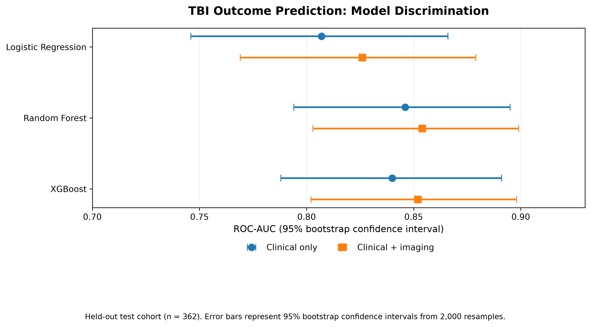

### Neurosurgery & Artificial Intelligence Portfolio
I am a clinician currently working in neurosurgery with interests in neuroscience, medical technology and the application of machine learning to clinical problems.
This portfolio documents a series of projects exploring how computational methods can be applied to prediction, medical imaging and physiological data in neurosurgery.
The emphasis is not only on model performance, but on clinical question formulation, methodological validity, interpretability and the limitations involved in translating machine-learning models into clinical practice.

---

## Projects

| Project | Clinical question | Methods | Status |
|---|---|---|---|
| **Traumatic Brain Injury Outcome Prediction** | Can early clinical and imaging information predict 90-day functional outcome after TBI? | Logistic regression, Random Forest, XGBoost, SHAP | **Completed** |
| **Glioma MRI Segmentation** | Can deep learning segment tumour-related regions on postoperative multimodal glioma MRI? | Multimodal MRI preprocessing, 3D U-Net, Dice-based evaluation, statistical analysis | **Completed** |
| **EEG Seizure Detection** | Can seizure activity be detected from EEG recordings using signal processing and machine learning? | Signal processing, machine learning, deep learning | **Planned** |
| **Intracranial Pressure Crisis Forecasting** | Can physiological time-series data provide early warning of intracranial hypertension? | Time-series analysis, machine learning, deep learning | **Future project** |

---

## Project 1 — Traumatic Brain Injury Outcome Prediction

**Status: Completed**

A prognostic machine-learning study using the multinational GNS-I traumatic brain injury cohort.

The project examines whether information available during early assessment can predict unfavourable functional outcome at 90 days, and whether structured imaging findings provide additional prognostic information beyond clinical assessment alone.

**Data source:** Global Neurosurgical Study-1 (GNS-I)  
[Original Nature Medicine study →](https://doi.org/10.1038/s41591-026-04600-6)

### Key findings

- Early clinical information provided useful discrimination for 90-day functional outcome.
- Random Forest and XGBoost demonstrated higher discrimination than the logistic-regression baseline.
- The clinical + imaging Random Forest achieved a held-out ROC-AUC of **0.854**, average precision of **0.706**, and Brier score of **0.114**.
- Adding imaging information produced relatively modest improvements in discrimination.
- Glasgow Coma Scale, pupil reactivity and age were the most influential predictors in the interpreted Random Forest model.

### Model Performance

*Comparison of held-out ROC-AUC across three model families using clinical-only and clinical-plus-imaging predictors. Adding imaging provided relatively modest improvements in discrimination.*

### Project Resources

**[View the TBI project showcase →](projects/tbi-outcome-prediction.md)**

*The underlying research repository is maintained privately while the work is under consideration for academic dissemination.*

---

## Project 2 — Glioma MRI Segmentation

**Status: Completed**

A deep-learning study investigating automated segmentation of postoperative glioma MRI using a multilabel three-dimensional U-Net.

Using the BraTS 2024 GLI dataset, the project investigates multimodal MRI preprocessing, segmentation of postoperative tumour-related regions, model development, and evaluation on a held-out test cohort with subject-level separation. Particular attention was given to resection-cavity segmentation, which presents challenges in postoperative neuro-oncological imaging.

### Key findings

- The selected model was evaluated on **198 held-out MRI examinations from 92 subjects**, with subject-level separation from the development cohorts.
- Baseline macro-average Dice across four segmentation regions was **0.6525**, increasing to **0.6630** following validation-informed resection-cavity post-processing.
- Among **157 examinations containing a reference resection cavity**, mean resection-cavity Dice improved from **0.5221 to 0.5638**.
- The mean paired improvement was **+0.0417** (95% subject-clustered bootstrap confidence interval: **+0.0227 to +0.0625**).
- Anatomical failure-case analysis identified important limitations, including deterioration in individual cases despite improved average performance.

The study illustrates the importance of evaluating medical-imaging models beyond aggregate accuracy, particularly when considering their potential clinical relevance.

### Clinical Failure Analysis — Anatomical Interpretation

*Representative held-out test case examined during anatomical failure analysis. The model's resection-cavity Dice score deteriorated markedly following post-processing (0.5345 to 0.0046). Review of the MRI and reference segmentation raised the possibility of annotation ambiguity, although an annotation error has not been independently confirmed.*

This case illustrates an important limitation of automated medical-image segmentation: quantitative performance metrics must be interpreted alongside the underlying anatomy and the quality of reference annotations.

### Project Resources

**[Read the Glioma MRI Segmentation project overview →](projects/glioma-mri-segmentation.md)**

[Read the full scientific report →](https://github.com/T-Y-Ang/glioma-mri-segmentation/blob/main/reports/glioma_segmentation_report.md)

[Explore the public GitHub repository →](https://github.com/T-Y-Ang/glioma-mri-segmentation)

---

## Portfolio approach

These projects are developed around clinically relevant questions rather than algorithm selection alone.

Across the portfolio, I aim to consider:

- appropriate clinical question formulation;
- data quality and missing information;
- prevention of information leakage;
- comparison with interpretable baseline models;
- discrimination and calibration;
- model interpretability;
- clinical and methodological limitations; and
- the distinction between internal model performance and clinical
  generalisability.

The projects are intended as educational and research work and should not be interpreted as clinically validated decision-support tools.

---

## Current Development

With the traumatic brain injury outcome prediction and glioma MRI segmentation studies completed, the next project will investigate **automated seizure detection from EEG recordings**.

This project will extend the portfolio into physiological signal processing and time-series deep learning, with an emphasis on clinically meaningful evaluation, subject-level data separation and model generalisability.

Future work may also explore intracranial pressure crisis forecasting and other applications of computational methods to neurosurgical research.
